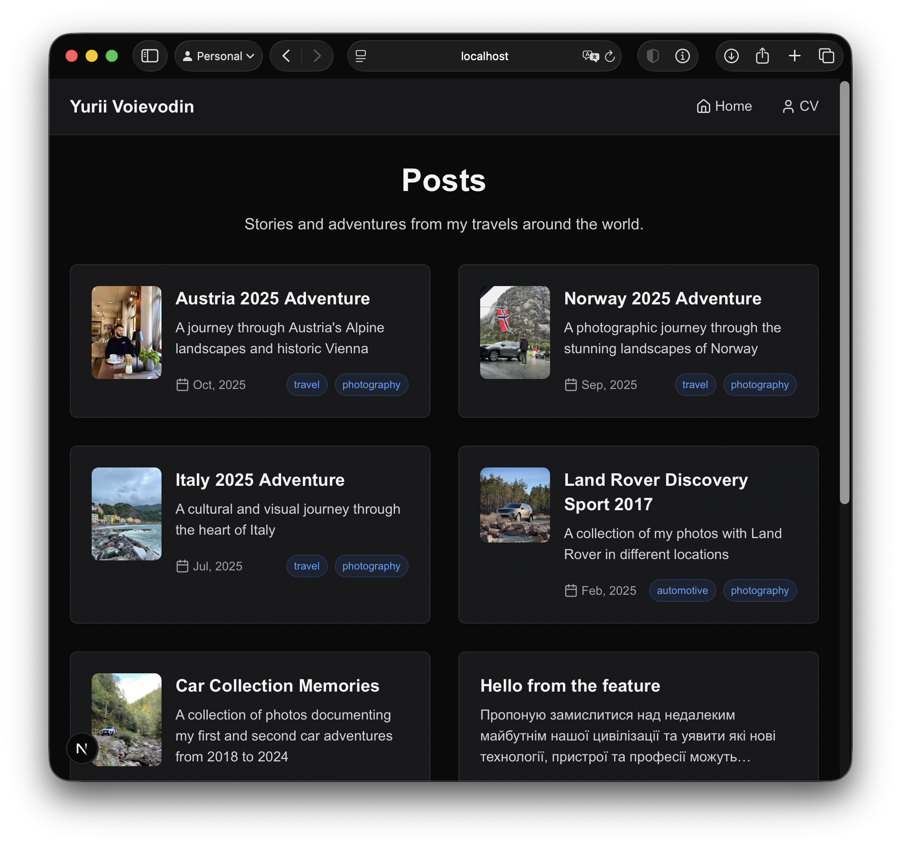

# Yurii Voievodin — personal site

CV, projects, travel blog and app landing pages, served from GitHub Pages as plain HTML and CSS. The browser receives no JavaScript.



## Build

Python 3.10+ standard library only — nothing to install.

```bash
python3 scripts/build.py           # writes dist/ and checks it
python3 scripts/build.py --serve   # the same, then serves it on http://localhost:8000
```

After every build the output is checked: no `<script>` other than JSON-LD, no leftover markers, every id, link and image resolves (canonical, `hreflang` and `og:image` included). Any problem fails the build.

## Structure

| Folder | What lives there |
|---|---|
| `pages/` | one HTML file per page; the path is the URL: `pages/cv.html` → `/cv/`, `pages/blog/index.html` → `/blog/`, `pages/wavefall/uk.html` → `/wavefall/uk/` |
| `layouts/` | the page frame: `base.html` plus `default`, `nav`, `blank`, and shared parts in `layouts/parts/` (footer, project headers, screenshot galleries) |
| `styles/` | CSS; `base.css` first, then the rest in name order, joined into `/static/site.css` |
| `public/` | images, videos, the CV PDF, icons — copied into the site as they are |
| `scripts/` | `build.py` (the whole build), `check.py` (output checks it runs), `icons.py` (icon shapes) |
| `docs/` | images for this README |

A page starts with its head data, then its HTML:

```html
<title>CV - Yurii Voievodin</title>
<meta name="description" content="…">
<meta name="layout" content="nav">
<meta name="sitemap" content="0.8 monthly">

<div class="…">…</div>
```

`layout` is `default` (content and footer) when omitted, or `nav` (with the top bar) or `blank` (content only). A page without `sitemap` stays out of `sitemap.xml`. Other head fields: `type` (`article` puts the page in the RSS feed and on `/blog/`), `published`, `image`, `keywords`, `lang`, `locale`, `robots`, `<link rel="canonical">` and `<link rel="alternate" hreflang>`. Open Graph, Twitter and the rest of `<head>` are generated from these. An `article` needs `image` and `published` (`YYYY-MM-DD`).

A page whose canonical is another page takes that page's title and description when it has none of its own; give it no `sitemap`, since only canonical URLs belong there. A page that includes another page must have that page as its canonical, so the two lines below always change together. `pages/projects/index.html` shows the latest project this way:

```html
<link rel="canonical" href="/projects/commercial/hooh/">

<!-- include: pages/projects/commercial/hooh.html -->
```

Markers inside HTML:

```html
<!-- include: layouts/parts/footer.html -->   insert another file
<!-- icon: ArrowLeft 16 -->                   an icon from scripts/icons.py, optional size
<!-- slot: posts -->                          the blog tiles, built from the posts' head data
{{ email }}                                   site values from scripts/build.py: email, github, linkedin, year, lang
```

A gallery is one `` per photo between two markers; the build writes the carousel or grid and a full-size viewer for each photo, with previous/next links in list order:

```html
<!-- gallery: hooh-shots carousel-tall -->


<!-- /gallery -->
```

The first word is the gallery id (viewer ids are `<id>-photo-1`, `-2`, …), the second its kind: `carousel-tall`, `carousel-wide`, `post-grid` (blog) or `personal-grid`. In carousels `alt` describes the screenshot; in grids it is the caption shown in the viewer, and a photo without one gets none.

## Deployment

Every push to `main` runs `.github/workflows/deploy.yml`: it builds and checks with Python and publishes `dist/` to GitHub Pages.
